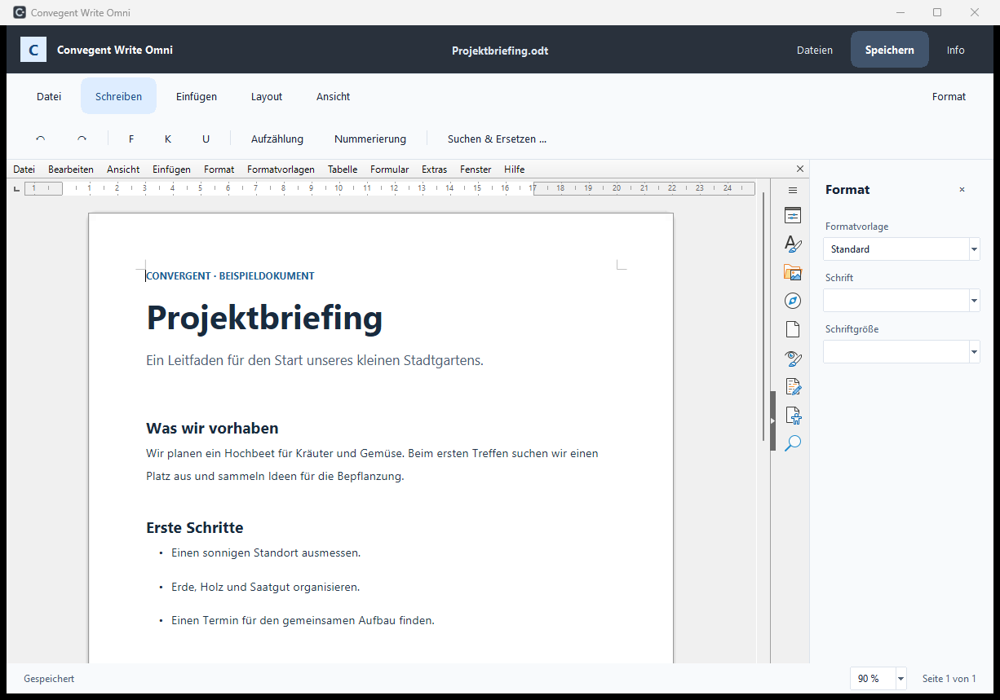

  

<h1 align="center">Convegent Write Omni</h1>

  Kostenlose Offline-Textverarbeitung von Convergent für Windows 11. 
  Schreibe auf A4, bearbeite DOCX- und ODT-Dateien und exportiere deine Dokumente als PDF.

  <a href="https://github.com/eronbubi/Omni-Write/releases/latest/download/Convegent-Write-Omni-Setup-x64.exe"><strong>↓ Für Windows 11 (x64) herunterladen</strong></a> 
  <a href="https://github.com/eronbubi/Omni-Write/releases/latest">Aktuelle Version und Änderungen</a> ·
  <a href="https://github.com/eronbubi/Omni-Write/releases/latest/download/Convegent-Write-Omni-Setup-x64.exe.sha256">SHA-256-Prüfsumme</a>

  

## Funktionen

- **Schreiben und formatieren** · Überschriften, Schriftarten, Absatzformate, Aufzählungen und Nummerierungen.
- **Dokumente gestalten** · Tabellen, Bilder, Links und Fußnoten einfügen. Seitenränder, Kopf- und Fußzeilen sowie Seitenzahlen einstellen.
- **Überarbeiten und drucken** · Rechtschreibprüfung, Suchen und Ersetzen, Navigation im Dokument und Druckvorschau.
- **Unterbrochene Arbeit fortsetzen** · Omni speichert ungesicherte Änderungen regelmäßig lokal und bietet beim nächsten Start an, den Entwurf wiederherzustellen.

## Dateiformate

| Format | Was du damit machen kannst |
| --- | --- |
| **DOCX** | Word-Dokumente öffnen, bearbeiten und speichern |
| **ODT** | OpenDocument-Dateien öffnen, bearbeiten und speichern |
| **PDF** | Fertige Dokumente zum Teilen exportieren |

Bei erkannten Kompatibilitätsrisiken bietet Omni **Kopie speichern** an. So bleibt die Originaldatei erhalten. Das Layout kann je nach installierten Schriftarten abweichen.

## Installation

1. Lade das [Windows-Setup](https://github.com/eronbubi/Omni-Write/releases/latest/download/Convegent-Write-Omni-Setup-x64.exe) herunter und öffne es.
2. Starte **Convegent Write Omni** über das Windows-Startmenü. Ein leeres A4-Dokument öffnet sich nach dem Einrichten der mitgelieferten Dokument-Engine.
3. Unter **Dateien** kannst du bestehende DOCX- und ODT-Dateien öffnen. Speichern, Drucken und PDF-Export findest du im Reiter **Datei**.

Die App benötigt Windows 11 x64. Das Setup ist unsigniert. Deine Dokumente und Entwürfe bleiben lokal auf deinem Gerät.

## Lizenz

Convegent Write Omni ist kostenlos und proprietär. Die App bringt eine LibreOffice-Writer-Engine mit. Die Lizenzen und Quellen der mitgelieferten Komponenten stehen in den [Drittanbieterhinweisen](THIRD-PARTY.txt).
